<div style="display: flex; flex-direction: column; align-items: center; gap: 10px; text-align: center; margin: 20px;">
  <div style="font-size: 0.9em;">
    <a href="https://github.com/ivan-lednev/obsidian-day-planner/issues?q=is%3Aissue+is%3Aopen+sort%3Areactions-%2B1-desc">Vote on issues</a>
    · <a href="https://github.com/ivan-lednev/obsidian-day-planner/issues">Report a bug or suggest a feature</a>
    · <a href="https://github.com/ivan-lednev/obsidian-day-planner/discussions/new?category=q-a">Ask a question</a>
    · <a href="./CONTRIBUTING.md">Contribute code</a>
  </div>

  <div>Day Planner is free for everyone. If it helps you plan your days, please consider supporting its development.</div>

  <a href="https://www.buymeacoffee.com/machineelf">
    
  </a>

</div>


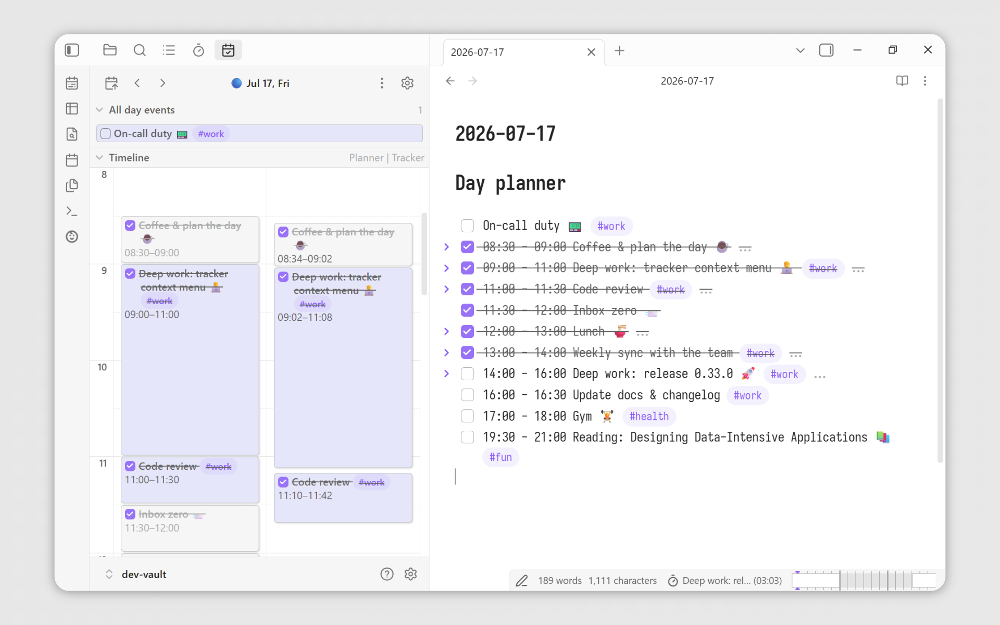
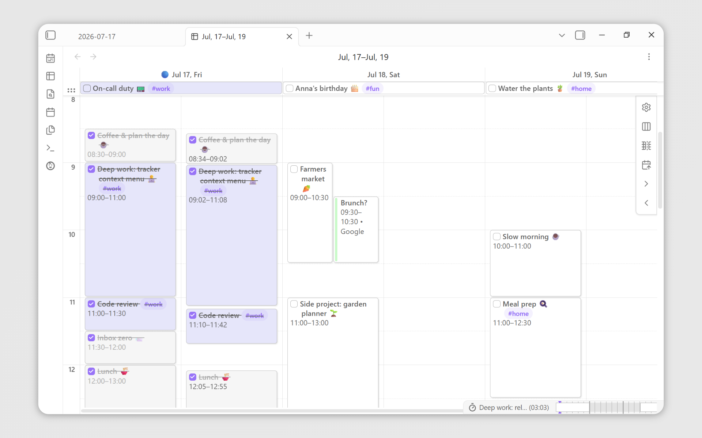

Day Planner is a community plugin for [Obsidian](https://obsidian.md/). It adds editable calendar views and basic time-tracking. Day Planner is integrated with

- The core Daily Notes plugin.
- [the Tasks plugin](https://obsidian.md/plugins?id=obsidian-tasks-plugin)
- Online calendars

## Table of contents

- [Table of contents](#table-of-contents)
- [How to use it](#how-to-use-it)
  - [1. Showing events from your daily notes](#1-showing-events-from-your-daily-notes)
  - [2. tasks community plugin integration, showing events from other files in your vault](#2-tasks-community-plugin-integration-showing-events-from-other-files-in-your-vault)
  - [3. Showing internet calendars](#3-showing-internet-calendars)
    - [Where to get a Google Calendar link](#where-to-get-a-google-calendar-link)
    - [Where to get an iCloud link](#where-to-get-an-icloud-link)
    - [Where to get an Outlook link](#where-to-get-an-outlook-link)
      - [Alternative](#alternative)
  - [4. Time tracking](#4-time-tracking)
    - [Recording clocks](#recording-clocks)
    - [Clocks in timelines](#clocks-in-timelines)
    - [Active clocks](#active-clocks)
    - [Limitations](#limitations)
  - [5. Meeting notes](#5-meeting-notes)
    - [Turning it on](#turning-it-on)
    - [What you get](#what-you-get)
    - [Templates](#templates)
- [Note on the old plugin version](#note-on-the-old-plugin-version)
- [Acknowledgements](#acknowledgements)

## How to use it

To open the timeline in the sidebar:

- Either run the command: `Show Timeline`
- Or click the timeline icon in the left ribbon
  - 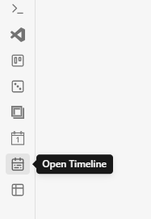

To open multi-day planner:

- Either run the command: `Show multi-day planner`
- Or click on the icon in the left ribbon:
  - 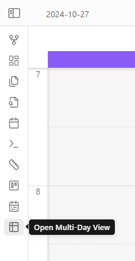

You can overview the upcoming 3 hours in the mini-timeline in the status bar:

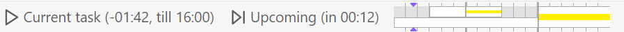

If there are remote tasks, the blocks will be colored accordingly.

The plugin can display records from different sources:

1. Daily notes
2. Obsidian-tasks
3. Online calendars
4. Dataview clock properties

Let's go over each one of them.

### 1. Showing events from your daily notes

> [!Warning]
> Either the core 'Daily Notes' (core plugin) or the 'Periodic Notes' (community plugin, [see in Obsidian](obsidian://show-plugin?id=periodic-notes)) should be enabled. This is what allows day-planner to 'see' and interact with your daily notes.

Write your tasks in a daily note, and they show up on the timeline:

```md
# Day planner

- [ ] 10:00 - 10:30 Wake up
- [ ] 11:00 - 12:30 Grab a brush and put a little make-up
```

### 2. [tasks community plugin](obsidian://show-plugin?id=obsidian-tasks-plugin) integration, showing events from other files in your vault

You can see tasks anywhere in the vault with dates added by the [tasks community plugin](obsidian://show-plugin?id=obsidian-tasks-plugin). This also works out of the box for all the files in the vault. You only need to add the `scheduled` property to a task in one of the formats:

- Shorthand, added by [tasks community plugin](obsidian://show-plugin?id=obsidian-tasks-plugin): `⏳ 2021-08-29`
  - Note that this plugin has a handy modal for adding these properties
- Full Dataview-like property: `[scheduled:: 2021-08-29]`
- Another Dataview format: `(scheduled:: 2021-08-29)`.

For example, these tasks will show up in the timeline:

```md
- [ ] #task 08:00 - 10:00 This task uses the shorthand format ⏳ 2021-08-29
- [ ] #task 11:00 - 13:00 This task uses the Dataview property format [scheduled:: 2021-08-29]
```

### 3. Showing internet calendars

To show events from internet calendars like **Google Calendar, iCloud Calendar and Outlook** you only need to add an ICS link in the plugin settings.

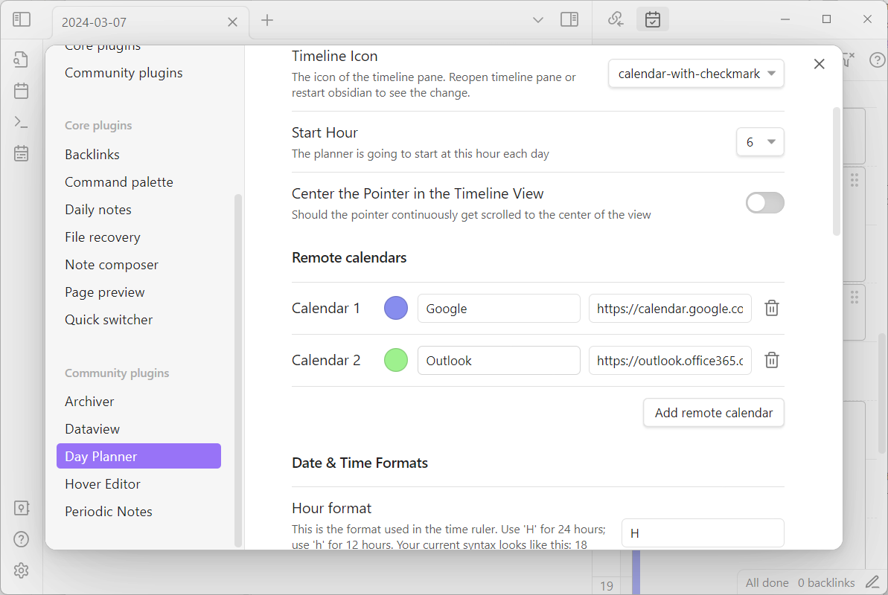

#### Where to get a Google Calendar link

> [!Warning]
> Make sure you copy the right link! It should end with `.ics`, otherwise, you won't see your events!

[Google Calendar instructions](https://support.google.com/calendar/answer/37648?hl=en#zippy=%2Csync-your-google-calendar-view-edit%2Cget-your-calendar-view-only)

#### Where to get an iCloud link

[iCloud Calendar instructions](https://www.souladvisor.com/help-centre/how-to-get-icloud-calendar-address-on-mac-in-ical-format)

#### Where to get an Outlook link

[Outlook Calendar instructions](https://support.microsoft.com/en-us/office/introduction-to-publishing-internet-calendars-a25e68d6-695a-41c6-a701-103d44ba151d?ui=en-us&rs=en-us&ad=us)

Here's the relevant part:

> Under the settings in Outlook **on the web**, go to Calendar > Shared calendars. Choose the calendar you wish to publish and the level of details that you want others to see.

Here's how the settings look on the web version:
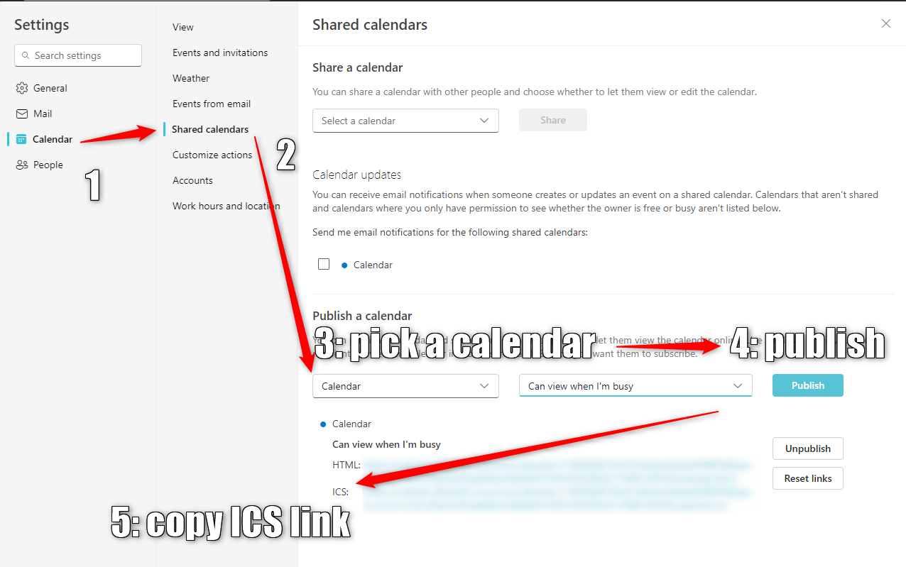

##### Alternative

If your organization doesn't let you share your calendar this way, you might try [a different way described in this issue](https://github.com/ivan-lednev/obsidian-day-planner/issues/395).

### 4. Time tracking

> [!Warning]
> This feature is experimental and can break or change at any time in the near future. You can help to shape this feature by providing your feedback.

You can record time spent on tasks in the form of Dataview properties and then view the records as time blocks, much like planner entries.

#### Recording clocks

Start a clock by right-clicking on a task in the editor:

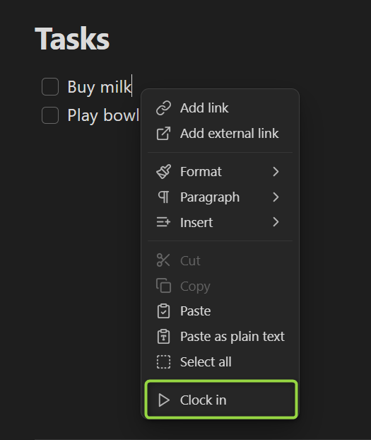

Stop the clock to record the time spent on a task or cancel it to discard the record:

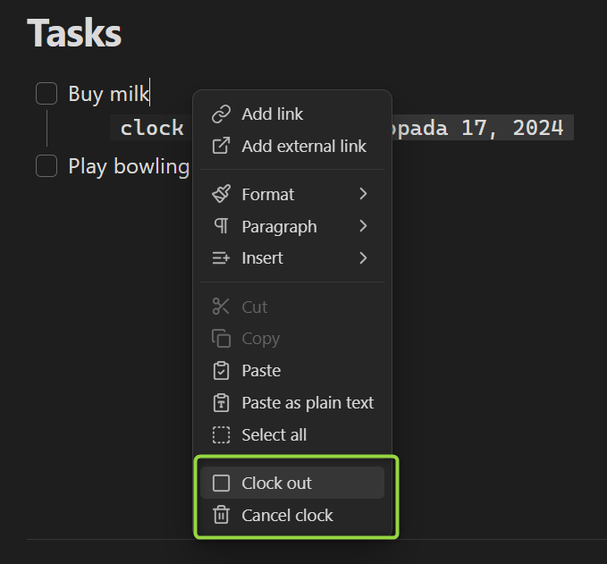

There is a command for each of the menu items, available in the command palette or as a hotkey:

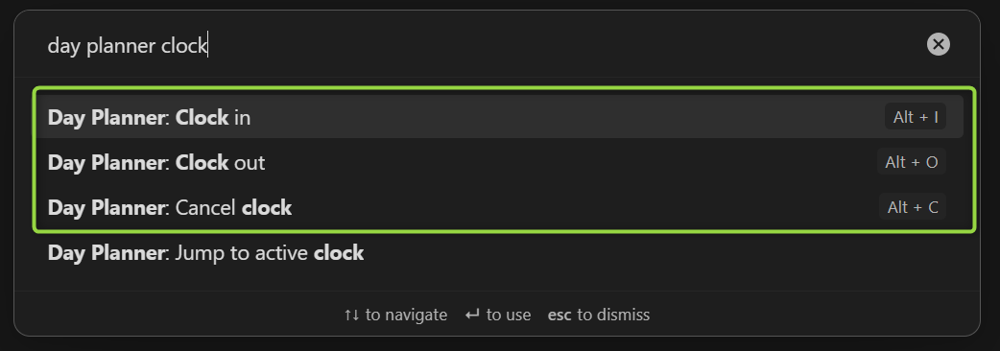

#### Clocks in timelines

You can enable an additional timeline column to see the recorded clocks next to your planner:

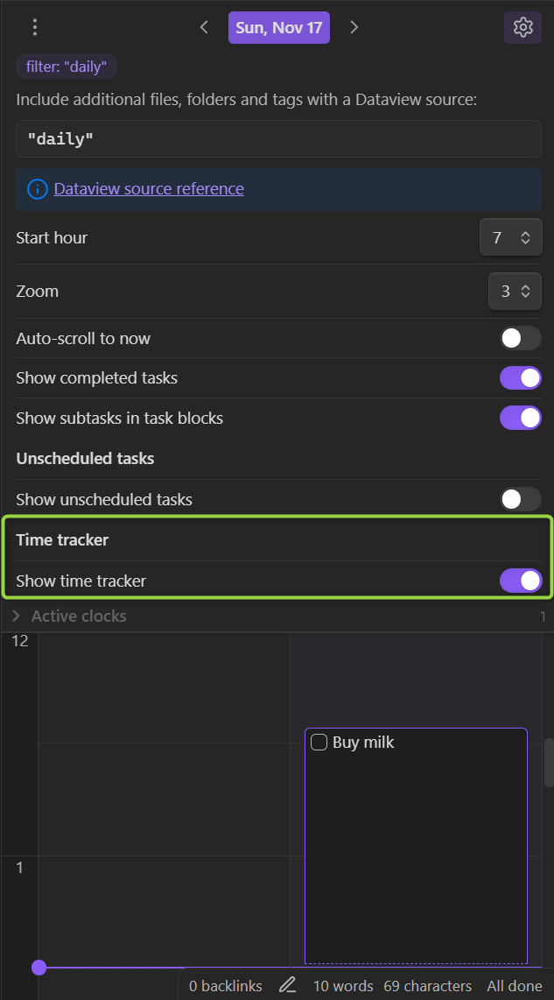

Right click (or tap and hold on mobile) a clock block to open its control menu:

- An active clock can be clocked out, edited or canceled
- A completed clock can be resumed, edited or deleted

#### Active clocks

You can see the currently active clocks in the timeline sidebar:

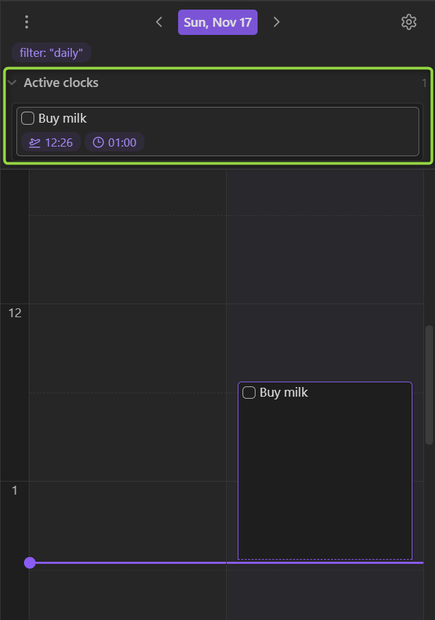

A right click on an active clock will bring the control menu:

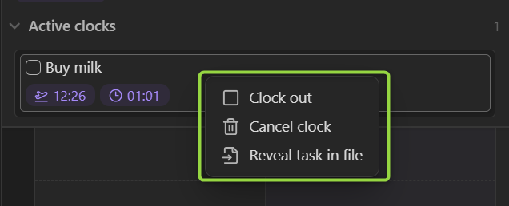

#### Limitations

- Clock time blocks cannot be edited by dragging yet. Use the context menu to edit clock times.

### 5. Meeting notes

Click an event from an internet calendar to take notes for this meeting. Day Planner creates a note for the meeting from your template and links it to your daily note. Click the event again, and the same note opens.

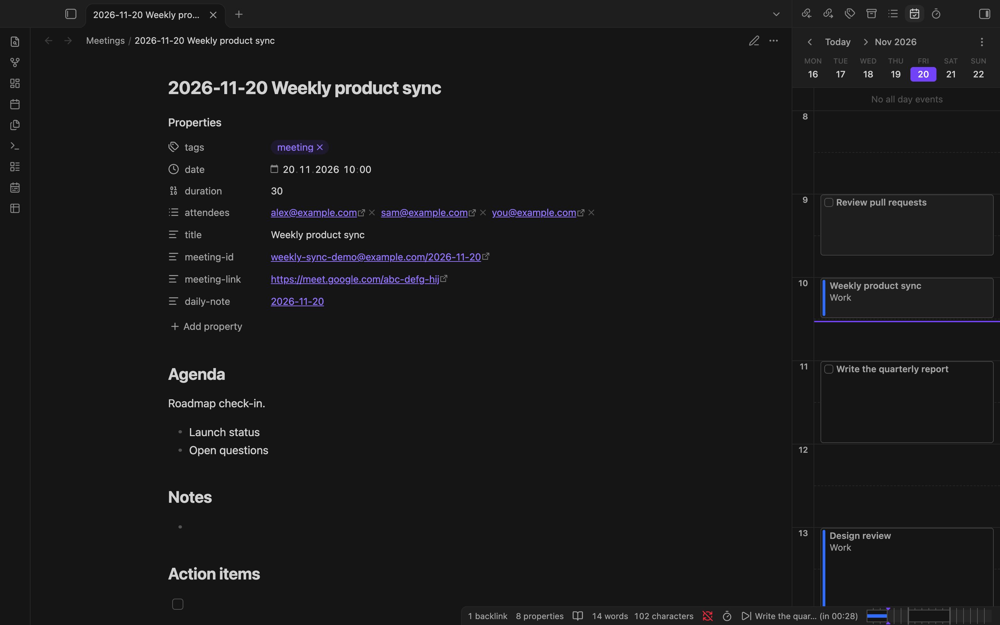

#### Turning it on

Meeting notes are off by default. Turn them on in the plugin settings under **Meeting notes**:

| Setting                                          | Default    | What it does                                                                    |
| ------------------------------------------------ | ---------- | ------------------------------------------------------------------------------- |
| Open meeting notes when clicking calendar events | Off        | Clicking or tapping an event from an internet calendar opens its note           |
| Meeting notes folder                             | `Meetings` | Where new meeting notes are created                                             |
| Meeting note template                            | None       | A note to use as the template (see [Templates](#templates))                     |
| Link meeting notes from daily notes              | On         | Adds a link to the meeting note in the daily note of that day, and a link back  |
| Meeting notes heading                            | `Meetings` | The heading in the daily note that links go under. It's created if it's missing |

The other settings show up once you turn the feature on.

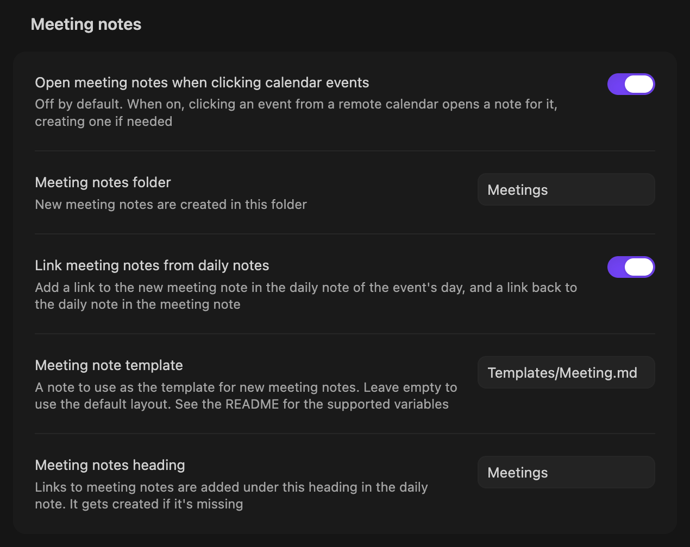

#### What you get

- **A note per meeting:** `Meetings/2026-11-19 Weekly sync.md`. Recurring events get a note per day
- **Properties:** `title`, `meeting-id`, `location` (a physical place), `meeting-link` (Google Meet, Zoom, Teams, Webex and others) and `daily-note`. A property is left out if the event doesn't have it
- **A link in your daily note:** `- [[2026-11-19 Weekly sync|10:00 - 10:30 Weekly sync]]` under the "Meetings" heading. It's never added twice

  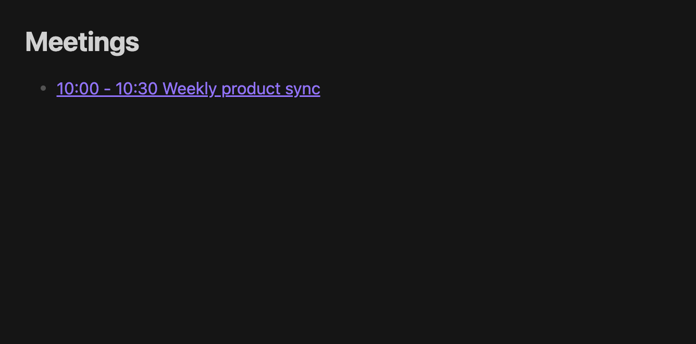

- **The same note every time:** clicking the event again opens the note you already have, even if you renamed or moved it

> [!Note]
> Meeting links are found in the conference details of the event (Google Meet, Microsoft Teams) or in its location and description.

#### Templates

Pick a template in the settings to control how meeting notes look. The properties above are always added to the note, and these variables are replaced:

| Variable                               | Value                                         |
| -------------------------------------- | --------------------------------------------- |
| `{{summary}}`                          | Event title                                   |
| `{{title}}`                            | Note name                                     |
| `{{meeting-id}}`                       | Event ID, stable between syncs                |
| `{{date}}`, `{{date:DD.MM.YYYY}}`      | Event date, with an optional format           |
| `{{time}}`, `{{start}}`, `{{end}}`     | Start and end times, with an optional format  |
| `{{time-range}}`                       | E.g. `10:00 - 10:30`                          |
| `{{duration}}`, `{{duration-minutes}}` | E.g. `1h 30m` and `90`                        |
| `{{location}}`, `{{meeting-link}}`     | Physical location and online meeting link     |
| `{{attendees}}`, `{{attendee-list}}`   | Attendee emails, comma-separated or as a list |
| `{{description}}`                      | Event description, as Markdown                |
| `{{daily-note}}`                       | A link to the daily note                      |
| `{{calendar}}`                         | Calendar name                                 |

Other text, like [Templater](https://github.com/SilentVoid13/Templater) commands, is left as is. Here is a template that adds more properties, so that you can find all meetings with someone using search or Bases:

```md
---
tags:
  - meeting
date: { { date:YYYY-MM-DDTHH:mm } }
duration: { { duration-minutes } }
attendees: [{ { attendees } }]
---

## Agenda

{{description}}

## Notes

## Action items

- [ ]
```

## Note on the old plugin version

0.7.0 significantly changes what the plugin looks like and what it does. If you like to have some of the old behaviors back, [consider creating an issue](https://github.com/ivan-lednev/obsidian-day-planner/issues).

If for some reason you still want to use the old version, there are community forks, which you can use via [BRAT](https://github.com/TfTHacker/obsidian42-brat). [Here is one such fork](https://github.com/ebullient/obsidian-day-planner-og).

## Acknowledgements

- Thanks to [Michael Brenan](https://github.com/blacksmithgu) for Dataview
- Thanks to [James Lynch](https://github.com/lynchjames) for the original plugin
- Thanks to [Joshua Tazman Reinier](https://github.com/joshuatazrein) for his plugin that served as an inspiration
- Thanks to @liamcain for creating daily note utilities and a helpful calendar plugin
- Thanks to [Emacs Org Mode](https://orgmode.org/) for an idea of text-based time-tracking
- Thanks to [Toggl Track](https://track.toggl.com/timer) for an idea of a great time-tracking UI
